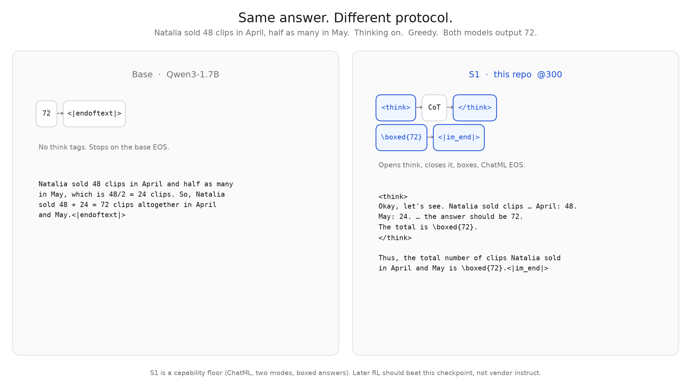
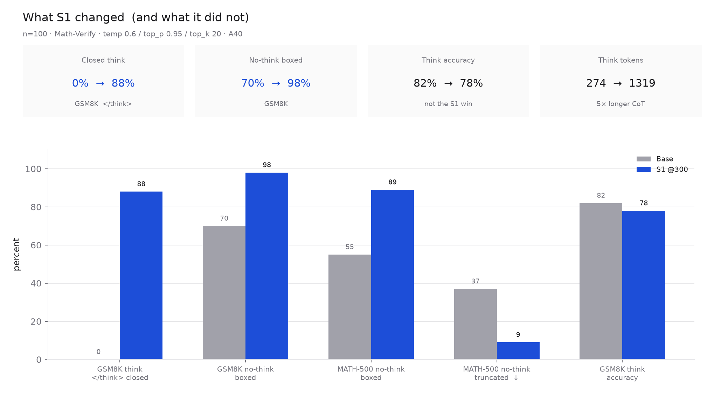
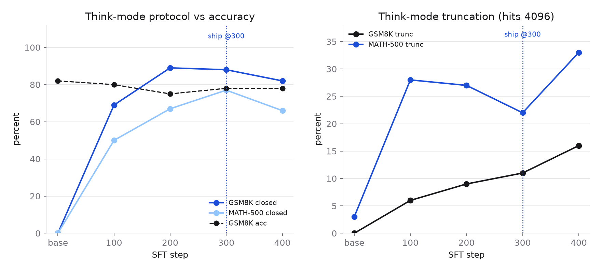

# qwen3-1.7b-rufus-s1

SFT stage (S1) of a small-scale replica of [*Rufus-Air*](https://arxiv.org/abs/2609.29421) on `Qwen/Qwen3-1.7B-Base`.

**This repo is `checkpoint-300` only.** Do not load [`syedamaan/qwen3-1.7b-rufus-s1-sft-v4-ckpts`](https://huggingface.co/syedamaan/qwen3-1.7b-rufus-s1-sft-v4-ckpts) at repo root — that file is **step 422**.



S1 is a **capability floor**, not a smarter calculator. It installs ChatML, two generation modes, `\boxed{}`, and stop on `<|im_end|>`. Later RL should beat **this** checkpoint.

| | |
|---|---|
| Student | `Qwen/Qwen3-1.7B-Base` (1.7B, tied embeddings) |
| Recipe | 1 epoch SFT, 13.5k rows, AdamW 2e-5 cosine, batch 32 |
| Pick | step **300** / 422 (plateau; 400+ worse on close/trunc) |
| Data | `syedamaan/rufus-s1-sft-data-v2` (private) |

## Use

`enable_thinking` is a **prompt** flag on one checkpoint.

```python
from transformers import AutoModelForCausalLM, AutoTokenizer

repo = "syedamaan/qwen3-1.7b-rufus-s1"
tok = AutoTokenizer.from_pretrained(repo)
model = AutoModelForCausalLM.from_pretrained(repo, torch_dtype="auto")

def generate(question, think=True, max_new=2048):
    prompt = tok.apply_chat_template(
        [{"role": "user", "content": question}],
        tokenize=False, add_generation_prompt=True, enable_thinking=think,
    )
    ids = tok(prompt, return_tensors="pt").to(model.device)
    out = model.generate(
        **ids,
        max_new_tokens=max_new,
        do_sample=True, temperature=0.6, top_p=0.95, top_k=20,
        eos_token_id=[151645, 151643],  # <|im_end|>, <|endoftext|>
        pad_token_id=151643,
    )
    return tok.decode(out[0, ids.input_ids.shape[1]:], skip_special_tokens=False)

print(generate("Natalia sold clips to 48 of her friends in April, and then she sold half as many clips in May. How many clips did Natalia sell altogether in April and May?", think=True))
print(generate("What is 17*23?", think=False))
```

- `enable_thinking=True` → prompt ends at `assistant\n`; model should open `<think>`, close `</think>`, then answer.
- `enable_thinking=False` → template inserts empty `<think>\n\n</think>\n\n`; model should answer only (no extra think tags).

Move the model to GPU yourself (`model.cuda()`). `device_map` needs `accelerate`.

## Eval

n=100, Math-Verify, temp 0.6 / top_p 0.95 / top_k 20, A40. Compare on **this** table, not to other protocols. n=100 is noisy (~5 pp).



| model | set | mode | acc | boxed | `</think>` | empty | trunc | tok |
|---|---|---|---|---|---|---|---|---|
| base | gsm8k | think | 82% | 88% | 0% | 0% | 0% | 274 |
| **s1@300** | gsm8k | think | **78%** | 89% | **88%** | **0%** | 11% | 1319 |
| base | gsm8k | no-think | 65% | 70% | 0% | 0% | 14% | 361 |
| **s1@300** | gsm8k | no-think | **70%** | **98%** | **0%** | 0% | 1% | 184 |
| base | math500 | think | 63% | 88% | 0% | 0% | 3% | 610 |
| **s1@300** | math500 | think | **60%** | 78% | **77%** | 0% | **22%** | 2094 |
| base | math500 | no-think | 38% | 55% | 0% | 0% | 37% | 624 |
| **s1@300** | math500 | no-think | **58%** | **89%** | 0% | 0% | **9%** | 374 |

Read it as: **format installed, CoT got long, answer rate did not leap.** MATH-500 no-think is the one accuracy jump (38% → 58%), mostly boxing + finishing instead of truncating.



@400: GSM8K closed 88% → 82%, MATH-500 think trunc 22% → 33%. Last checkpoint is not best.

## No-think demo (same Natalia prompt)

BASE — boxed, but `Assistant:` preamble and `<|endoftext|>`:

```
Assistant: Let's break down the problem step by step:
...
**Final Answer:**
\boxed{72}<|endoftext|>
```

S1 — no extra think tags, boxed, `<|im_end|>`:

```
Natalia sold 48 clips in April.
In May, she sold half as many clips as in April, which is 48 / 2 = 24 clips.
Altogether, Natalia sold 48 + 24 = 72 clips in April and May.
Thus, Natalia sold \boxed{72} clips altogether in April and May.<|im_end|>
```

Short arithmetic under **greedy** is a bad demo for base (`What is 17*23?` loops `paque` / `umably` because ChatML is OOD). Eval used sampling. S1 no-think on that prompt is `391` + `<|im_end|>`. S1 think computes 391 then ruminates and can hit the token cap without `</think>` — that length bug is P2, not a failed S1.

## Training (v4)

- 13,500 prompt-completion rows (OpenR1 math-think, Tulu chat/code/IF/GSM8K-short, Hermes tools). Token mix ~75% math-think.
- `SFTTrainer`, `completion_only_loss`, `batch_rebalance`, no packing, no `group_by_length`.
- Eight control-token embedding rows started as the **same placeholder** (`<think>` == `</think>` == `<|im_end|>`). Replaced with the mean of spelling sub-tokens (Hewitt). Tied input/output embeddings.
- LR 2e-5, warmup 5%, cosine, AdamW β₂=0.95, wd 0.1, clip 1.0, bf16, grad checkpointing. 422 steps × batch 32.

v1–v3 were bugs, not ablations: wrong mask, length-grouped curriculum, identical control embeddings. Ship v4@300.

## What this is not

- Not `Qwen/Qwen3-1.7B` (vendor instruct; GSM8K think 86% under the same protocol).
- Not RL. P2 should start **here** and beat GSM8K think **78%** and MATH-500 think trunc **22%** without breaking no-think boxed **98%** / closed **88%**.
- Think-mode traces are ~5× longer than base. Rumination and 4096-truncation are the remaining failure modes.

## Checkpoints

All steps: [`syedamaan/qwen3-1.7b-rufus-s1-sft-v4-ckpts`](https://huggingface.co/syedamaan/qwen3-1.7b-rufus-s1-sft-v4-ckpts) (`checkpoint-{100,200,300,400,422}`). Prefer **300**.
