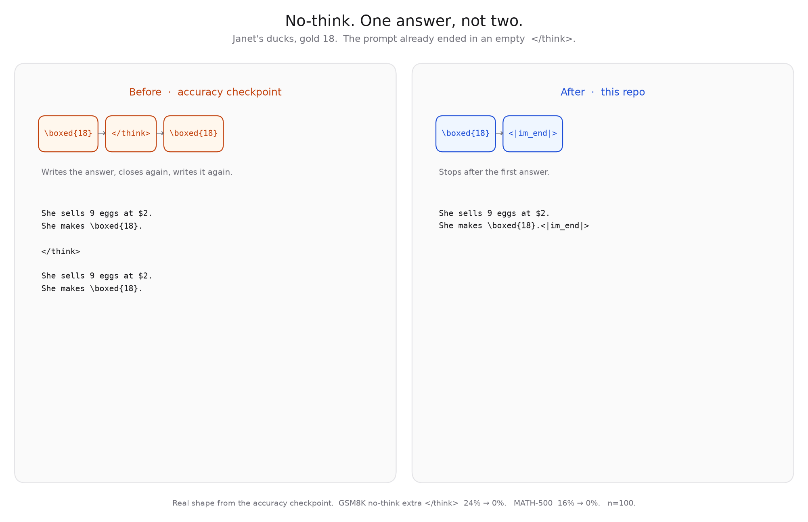
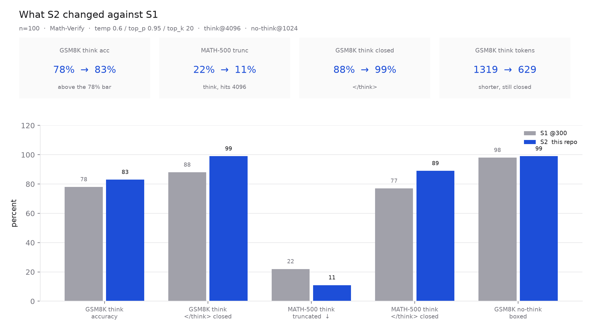
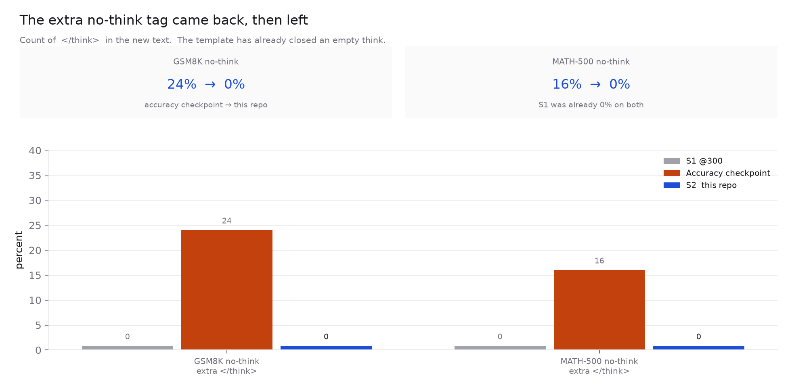

# qwen3-1.7b-rufus-s2-reasoning-rl

Reasoning RL stage (S2) of a small-scale replica of [*Rufus-Air*](https://arxiv.org/abs/2609.29421), started from [`syedamaan/qwen3-1.7b-rufus-s1`](https://huggingface.co/syedamaan/qwen3-1.7b-rufus-s1).



These weights are **1400** GSPO steps after S1, one GSM8K-train prompt per step, 8 completions each. KL coefficient 0. AdamW at 1e-6. The completion cap is 1024.

| steps | from | what changed |
|---:|---|---|
| 200 | S1 @300 | New think reward. Format held. GSM8K think accuracy 77%, so the 78% bar was missed. |
| 1000 | that checkpoint | Same reward. GSM8K think 85%, closed 98%, 618 tokens. MATH-500 think truncation 13%. No-think answers grew a second `</think>` on 24% of GSM8K and 16% of MATH-500. |
| 100 | that checkpoint | Half the prompts are no-think. Those pay 1 only for one boxed answer with no think tag. |
| 100 | the step above | Same mix, new optimizer. **This repo.** |

The think reward pays a closed think of at least 128 tokens, a boxed answer that passes Math-Verify, and then decays across the last 256 tokens before the cap. A group is kept only when its mean score is in (0, 0.8].

An earlier reward, which paid the shortest correct trace even when `</think>` was missing, collapsed the think tag inside 200 steps. Those weights are not in this lineage. The 1000-step accuracy checkpoint is not this repo either.

## Use

`enable_thinking` is a **prompt** flag on one checkpoint.

```python
from transformers import AutoModelForCausalLM, AutoTokenizer

repo = "syedamaan/qwen3-1.7b-rufus-s2-reasoning-rl"
tok = AutoTokenizer.from_pretrained(repo)
model = AutoModelForCausalLM.from_pretrained(repo, torch_dtype="auto")

def generate(question, think=True, max_new=2048):
    prompt = tok.apply_chat_template(
        [{"role": "user", "content": question}],
        tokenize=False, add_generation_prompt=True, enable_thinking=think,
    )
    ids = tok(prompt, return_tensors="pt").to(model.device)
    out = model.generate(
        **ids,
        max_new_tokens=max_new,
        do_sample=True, temperature=0.6, top_p=0.95, top_k=20,
        eos_token_id=[151645, 151643],  # <|im_end|>, <|endoftext|>
        pad_token_id=151643,
    )
    return tok.decode(out[0, ids.input_ids.shape[1]:], skip_special_tokens=False)
```

- `enable_thinking=True` → prompt ends at `assistant\n`; model should open `<think>`, close `</think>`, then answer.
- `enable_thinking=False` → template inserts empty `<think>\n\n</think>\n\n`; model should answer only (no extra think tags).

## Eval

Same frozen protocol as S1. n=100, Math-Verify, temp 0.6 / top_p 0.95 / top_k 20, think at 4096, no-think at 1024. One seeded pass. n=100 is noisy (~5 pp).



| model | set | mode | acc | boxed | `</think>` | trunc | tok |
|---|---|---|---|---|---|---|---|
| s1@300 | gsm8k | think | 78% | 89% | 88% | 11% | 1319 |
| **s2** | gsm8k | think | **83%** | 99% | **99%** | **1%** | 629 |
| s1@300 | gsm8k | no-think | 70% | 98% | 0% | 1% | 184 |
| **s2** | gsm8k | no-think | **85%** | **99%** | **0%** | 1% | 222 |
| s1@300 | math500 | think | 60% | 78% | 77% | 22% | 2094 |
| **s2** | math500 | think | **68%** | 89% | **89%** | **11%** | 1611 |
| s1@300 | math500 | no-think | 58% | 89% | 0% | 9% | 374 |
| **s2** | math500 | no-think | **66%** | 90% | **0%** | 10% | 463 |



The accuracy run, before this mix, had GSM8K think accuracy 85% and the extra no-think tag at 24% / 16%. This repo gives two points of that accuracy back and removes the tag. 83% against 85% is inside the noise. 24% against 0% is not.

## What this is not

- Not the accuracy-only checkpoint. That one still duplicates the no-think answer.
- Not `Qwen/Qwen3-1.7B` (vendor instruct).
- Think traces are shorter than S1 and still closed. The 1024 training cap is below the old MATH think length, so the long-proof budget was not raised here.
